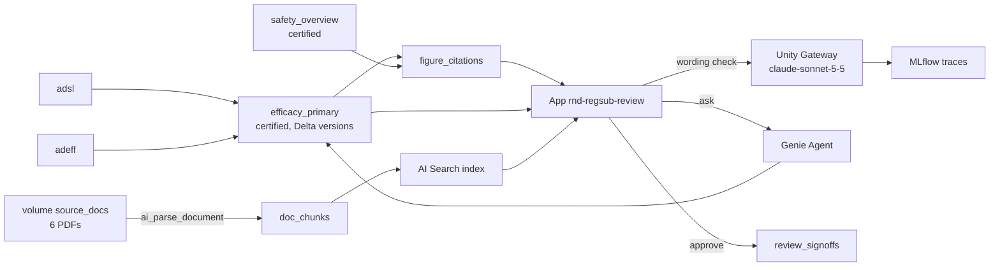

# Demo plan: GSK, rnd_regsub_review

Status: APPROVED (19 Oct 2026, Sean)
This file is the only input `demo-build` reads. It must make sense without the planning conversation.

Context: the demo supports Sean's regulatory section on the Jiajie Zhang call (Tue 20 Oct 2026, 14:00 UK) and the Raj Harapanahalli session (Fri 6 Nov). Narrative: `~/Projects/gsk/_decks/jiajie/regsub/narrative.md`. Its frame is that a draft can be wrong in 3 ways (the data, the model, the reading), and only the reading needs an expert. This demo shows the data way going right, and shows the platform handing the reading to a person.

## 0. Identity (per demo-hygiene)
| | Value |
|---|---|
| Name | `rnd_regsub_review` |
| Workspace | `fe-vm-sean-zhang` (default) |
| Schema | `sean_zhang_catalog.rnd_regsub_review` |
| Tags | `sz_domain=rnd`, `sz_project=regsub_review`, `asset_class=app` |
| Local folder | `~/Projects/gsk/rnd_regsub_review` |
| GitHub | `sean-zhang-dbx/rnd-regsub-review`, private, topics: `domain-rnd`, `account-gsk`, `app`, `demo` |
| App | `rnd-regsub-review` |
| Stack | AppKit |

## 1. Problem
- **Customer / audience in the room:** GSK R&D. Jiajie Zhang (VP AI/ML R&D, Enterprise Data & AI; previously led AI/ML at Sanofi R&D and Evinova), plus Mike Sanky and Tansy from Databricks. Technical, senior, and skeptical of feature tours.
- **Persona using the screen:** a regulatory reviewer checking a CSR section and its downstream summaries before sign-off.
- **One sentence:** A regulatory reviewer cannot tell which sentences in the CSR, Module 2 and the label carry wrong numbers after a certified analysis table is restated, which costs days of manual cross-checking on the critical path to submission. With Databricks they see every affected sentence within seconds, with the corrected figures recomputed from the certified source and the single wording change that still needs a person flagged for them.
- **Source of the pain:** assumption, based on public industry results (Pfizer and Merck CSR drafting) where checking a draft against its tables is the remaining effort. Confirm with Jiajie on the call.
- **Success metric:** time from a table restatement to knowing every affected sentence: days of manual search (assumption) to under 1 minute.
- **Demo length:** 3 to 4 minutes, inside a 10-minute section.
- **Data:** fully synthetic. One fictional Phase III study, `LMN-301` (compound LMN-4471 vs placebo), so no GSK product or data appears.

## 2. Experience
- **Opening screen (last thing first):** a restatement alert for study LMN-301. Biostatistics restated `efficacy_primary` at 09:12. That restatement affects **7 sentences in 4 sections**:
  - 5 figures can be recomputed from source.
  - 1 label sentence goes to Labelling.
  - 1 sentence may need the writer, because its wording may no longer hold.
  - The overview reflects the review state. Before "Recompute from source" it uses the wording above, with blue (cited) bars for figures and amber for the 2 hand-offs. After the recompute it reads "5 recomputed and waiting for approval, 1 sent to Labelling, 1 with the writer", with green bars. (Decision: Sean, 19 Oct 2026, after review round 1, so the overview and the section view never contradict each other.)
  - 6 safety sentences that cite other tables are listed as "unchanged".
  - Below the dossier, a second line reads: **AI Search found 2 documents outside the dossier that still quote the old result**, the Investigator's Brochure and the advisory briefing book. They are sent to their owners. Nothing outside the dossier is rewritten.

  Presenter's first line: "Biostatistics restated the primary efficacy table. Before anyone opened a document, the reviewer already knew the 7 sentences it touches, that only one of them needs a person, and that 2 documents outside the dossier still quote the old number."

| # | Audience sees | Problem it answers | What Databricks does | Databricks object | Presenter line | Link key |
|---|---|---|---|---|---|---|
| 1 | The restatement alert above: the 7 affected sentences grouped by document, the 6 unchanged safety sentences greyed out, and the 2 documents found outside the dossier, each with its matching passage | "What did this change break, including in documents nobody linked to the data?" | Compares the 2 versions of the certified table and joins the changed cells to the citation records. For documents with no citation records, AI Search runs a hybrid search over parsed PDFs in a Unity Catalog volume for the old result | `efficacy_primary` (Delta version history), `figure_citations`, volume `source_docs`, `doc_chunks` (ai_parse_document), AI Search index `doc_chunks_index` | "Documents built on the platform know their sources. For the ones that aren't, such as the brochure, AI Search finds every passage that still quotes the old result." | `beat1`, `beat1_search` |
| 2 | Open CSR 11.4.1. The paragraph shows each figure highlighted. Hover over "412 of 618" and a citation card appears: table, query, table version 3, "Certified by Biostatistics, 19 Oct 2026" | "Where did this number come from?" | Each figure is the result of a query against a certified Unity Catalog table, and certification is a governed tag | UC table with certification tag + lineage to `adsl`/`adeff` | "Nobody typed this number. A query against the certified table wrote it, so the source is one click away." | `beat2` |
| 3 | **Hero.** Click "Recompute from source". Old and new values sit side by side: 412 of 618 (66.7%) becomes 409 of 618 (66.2%), and the treatment difference goes from 19.5 to 19.1 points. 5 figures update across CSR 11.4.1, Module 2.7.3 and Module 2.5, and the prose stays untouched. Then one sentence turns amber: "about two-thirds of participants responded". A model check reports that 66.2% no longer supports "two-thirds" and sends the sentence to the writer. The label sentence shows "Sent to Labelling" | "Fix the numbers, but tell me where the meaning changed" | SQL recomputes every figure live on a SQL warehouse. A model called through Unity Gateway checks each updated sentence against its new figures, and MLflow traces that call | SQL warehouse queries, Unity Gateway endpoint, MLflow trace | "SQL fixed the numbers. The model's only job was to read the prose and tell us where the meaning may have changed, and that one sentence is the reviewer's call." | `beat3` |
| 4 | The reviewer opens the Genie Agent panel and asks "How many participants in the treatment arm met the primary endpoint after the restatement?" The answer is 409 of 618, with the SQL shown. The reviewer clicks Approve on the 5 figures, and a named sign-off with a timestamp is recorded | "Can I trust the fix without emailing the statistician?" | The Genie Agent answers from the same certified tables, and the approval is written to a governed table | Genie Agent "Regsub Review: LMN-301 certified tables", `review_signoffs` table | "The check that used to be an email thread to the statistician is now a question to the same certified data, and the sign-off is on record." | `beat4` |

- **Hero moment:** beat 3.
  - **What happens on screen:**
    - 0 s: click "Recompute from source".
    - 1 to 3 s: the 5 figures flip from old to new with a short highlight.
    - 3 to 6 s: the model check runs, the amber flag appears on the "two-thirds" sentence, and the label row moves to "Sent to Labelling".
    - Presenter hovers the amber flag, and the model's one-line reason shows: "66.2% is below two-thirds, so 'about two-thirds' may no longer hold. The writer decides."
  - **Why it matters to Jiajie:**
    - The demo separates what is deterministic (SQL, lineage) from what is judgement (prose), which is the governance question a VP of AI/ML in a GxP setting cares about most.
    - The model isn't trusted with numbers. It is used narrowly, as a reader that hands off to a person.
- **Must be true in the data:**
  1. `efficacy_primary` has 2 Delta versions for LMN-301. In the earlier version the treatment arm shows `responders=412, n=618` (66.67%). The current version shows `409, 618` (66.18%). Placebo shows `287, 609` (47.13%) in both versions.
  2. Exactly 7 sentence rows in `figure_citations` cite cells that changed between the versions. They sit in CSR 11.4.1 (3), Module 2.7.3 (2), Module 2.5 (1) and the label section 14 (1).
  3. Exactly 6 sentences cite safety tables and are unaffected.
  4. Exactly 1 affected sentence contains the phrase "two-thirds". Exactly 1 affected sentence has `doc_type='label'`.
  5. Recomputing every changed figure through `config/queries` against the current version gives exactly the new values: 409/618, 66.2%, a difference of 19.1 points, and the new 95% CI.
  6. The Genie Agent answers the scripted question with 409 of 618.
  7. A hybrid AI Search query for the old result ("412 of 618" / "66.7%" / "two-thirds responded") returns passages from exactly 2 of the 6 volume PDFs in its top 5 (the Investigator's Brochure v7 and the advisory briefing book). The protocol, SAP, DSUR and plain-language summary draft don't match.
- **Fallback if it fails live:**
  - The model check result is cached per sentence, and the app shows the cached result if the endpoint is slow (more than 8 s).
  - A recorded run of beats 3 and 4 is saved as `docs/fallback.mp4`.
  - A Genie Agent answer screenshot is ready.
- **Presenter toggle:** links are hidden by default. Press `D`, or use the small "Databricks" switch at the top right, to show "See it in Databricks" links on every beat.
- **Cut list:**
  - Live drafting of a full CSR section by an LLM: drafting being cheap is the opening claim, so showing it adds no new information and costs time.
  - Agent Bricks agents: no agent is needed, the CLI is Beta, and the narrative keeps Beta off the main path.
  - MLflow evaluation run: covered on deck slide 6 ("model upgrade as change-control"); in the demo it would be a second hero.
  - eCTD publishing, Veeva Vault, Lakeflow Connect: off the storyline; the Veeva connector is Beta.
  - Automatic rewrite of the label sentence: labelling owns it, and an expert would distrust a system that edits label text.
  - Genie Agents over files (Beta): considered for beat 4. Sean chose AI Search for untracked documents in beat 1 instead, to keep one path.
  - Rewriting documents outside the dossier: they belong to other owners, so the demo only flags them.
  - Multiple studies: one study keeps one path.

## 3. Databricks mapping
Workspace `fe-vm-sean-zhang`, catalog `sean_zhang_catalog`, warehouse `Serverless Starter Warehouse` (`16ad82bead3f55b5`). Statuses come from `~/Projects/gsk/_decks/jiajie/research/databricks_playbook.md` section 6, which was checked against the Azure release notes up to 19 Oct 2026. Recheck any status you are unsure of with `databricks:databricks-docs`.

| Beat | Capability (current name) | Status | Source link |
|---|---|---|---|
| 1 | Delta table version history (`DESCRIBE HISTORY`, `VERSION AS OF`) on a Unity Catalog table | GA | docs: delta/history |
| 1 | Unity Catalog volume (`source_docs`), ai_parse_document, AI Search hybrid index on endpoint `sz-shared-vs` | GA (Volumes, ai_parse_document, AI Search) | docs: volumes; ai_parse_document; vector-search |
| 2 | Unity Catalog certification tag (`system.certification_status = certified`) and column lineage `adsl`/`adeff` → `efficacy_primary` | GA | docs: certify-deprecate-data; data-lineage |
| 3 | SQL warehouse queries (AppKit analytics plugin); Claude Sonnet 5.5 (`databricks-claude-sonnet-5-5`) called through Unity Gateway with usage tracking and an inference table; MLflow tracing | GA (Unity Gateway since 4 Aug 2026; MLflow 3 tracing) | release notes Aug to Oct 2026 |
| 4 | Genie Agent over the certified tables (Conversation API); sign-off written to a Unity Catalog table | GA | docs: genie-agents |
| all | Databricks Apps (AppKit) | GA | docs: apps |

No agent is used, so the Agent Bricks CLI default does not apply. The wording check is a single, traced model call with a fixed model version, and it is not an agent.



## 4. Contract
All tables are in `sean_zhang_catalog.rnd_regsub_review`. The data is synthetic, for the fictional study `LMN-301` (LMN-4471 400 mg once daily vs placebo, 52 weeks).

**Data model**
| Table | Columns (name type) | Rows | Notes |
|---|---|---|---|
| `adsl` | usubjid string, study_id string, arm string ('LMN-4471 400 mg','Placebo'), age int, sex string, country string, randfl string ('Y') | 1,227 (618 + 609) | Subject-level analysis set |
| `adeff` | usubjid string, paramcd string ('PRIMRESP'), avisit string ('Week 52'), aval int (1 responder, 0 not), adjudicated_at timestamp | 1,227 | Responders are 412 treatment and 287 placebo at first; 3 treatment subjects change from 1 to 0 at the restatement |
| `efficacy_primary` | row_key string, study_id string, arm string, n int, responders int, rate_pct double, diff_pct double, ci_low double, ci_high double | 3 (treatment, placebo, difference row) | **Certified** (tag `system.certification_status=certified`, plus a table comment naming Biostatistics). It is built from `adeff`, so lineage exists. It has at least 2 Delta versions: the earlier one with 412 and the current one with 409. The Wald 95% CI for the difference moves from 14.1 to 25.0 to 13.6 to 24.5 |
| `safety_overview` | row_key string, study_id string, arm string, n int, any_teae int, serious_ae int, ae_discontinuation int, deaths int | 2 | Certified, unchanged by the restatement |
| `document_sentences` | sentence_id string, doc_type string ('csr','m27','m25','label'), section string ('11.4.1','2.7.3','2.5','14'), section_title string, seq int, template string (with `{fig_key}` placeholders), text_v_prev string | 13 cited sentences + about 10 plain prose sentences for realism | 7 cite efficacy figures, and 6 cite safety figures |
| `figure_citations` | citation_id string, sentence_id string, fig_key string, source_table string, row_key string, column_name string, table_version bigint, value_text string, query_key string, certified_by string, certified_at timestamp | about 20 | Each figure maps to one cell of a certified table at a version |
| `wording_checks` | sentence_id string, table_version bigint, verdict string ('ok','needs_writer'), reason string, model string, trace_id string, checked_at timestamp | cache | Written by the wording-check route and read as the fallback |
| Volume `source_docs` | 6 synthetic PDFs (3 to 8 pages each): `LMN-301_Protocol_v3.pdf`, `LMN-301_SAP_v2.pdf`, `LMN-4471_Investigators_Brochure_v7.pdf`, `LMN-4471_Advisory_Briefing_Book_draft.pdf`, `LMN-4471_DSUR_2025.pdf`, `LMN-301_Plain_Language_Summary_draft.pdf` | 6 files | IB and briefing book quote the old result (412 of 618, 66.7%, "about two-thirds"). Others mention LMN-301 but not that result |
| `doc_chunks` | chunk_id string, file_path string, doc_title string, page int, chunk_text string | about 100 to 200 | From `ai_parse_document` then chunking; Change Data Feed on, for a Delta Sync index |
| `review_signoffs` | signoff_id string, sentence_id string, action string ('approved','sent_to_labelling','sent_to_writer','notified_owner'), reviewer string, table_version bigint, signed_at timestamp | starts empty | Written by the approve route, and by "Notify owners" in beat 1 (action `notified_owner`, one row per untracked document, with the document's `file_path` in `sentence_id`; decision: Sean, 19 Oct 2026). The reviewer is "Dr. Amara Okafor, Regulatory Review" (fictional) |

**Must be true** (backend runs these as checks and reports the results):
1. `efficacy_primary` history shows the earlier version with treatment responders 412 and the current version with 409. Placebo is 287/609 in both.
2. Comparing the versions with `figure_citations` returns exactly 7 sentences: CSR 11.4.1 (3), m27 2.7.3 (2), m25 2.5 (1), label 14 (1).
3. The 6 safety-citing sentences are not returned.
4. Exactly 1 affected sentence contains "two-thirds" (CSR 11.4.1). Exactly 1 affected sentence has `doc_type='label'`.
5. `recompute_figures` against the current version returns 409, 618, 66.2, 19.1, 13.6 and 24.5 for the cited keys.
6. The Genie Agent answers "How many participants in the treatment arm met the primary endpoint after the restatement?" with 409 of 618.
7. The wording check on the "two-thirds" sentence with the new figures returns `needs_writer`, and every other affected sentence returns `ok`. Run it 3 times; if it is not stable, tighten the prompt and use temperature 0.
8. A hybrid query on `doc_chunks_index` for the old values returns passages from exactly the Investigator's Brochure v7 and the advisory briefing book, and none from the other 4 PDFs.
9. `efficacy_primary` Delta history shows the pre-restatement state as **version 3** and the restated state as **version 4**. The deck quotes these values, so set them up deliberately, for example by creating with 3 setup commits and then 1 restatement commit. Delta commit timestamps cannot be backdated, so the business time of the restatement (19 Oct 2026 09:12, Biostatistics) is recorded in `adeff.adjudicated_at` and in the version 4 commit's `userMetadata` (set `spark.databricks.delta.commitInfo.userMetadata`, for example `{"restated_at":"2026-10-19T09:12:00Z","restated_by":"Biostatistics"}`). `restatement_summary.restated_at` and `restated_by` come from that metadata, not from the commit timestamp. The History tab shows the real commit time, which is expected. (Decision: Sean, 19 Oct 2026.)

**Queries** (`config/queries/<key>.sql`, AppKit analytics)
| Key | Used by beat | Result columns (name type) |
|---|---|---|
| `restatement_summary` | 1 | table_name string, prev_version bigint, curr_version bigint, restated_at timestamp, restated_by string, changed_cells int |
| `impact_list` | 1 | sentence_id string, doc_type string, section string, section_title string, seq int, fig_key string, old_value string, new_value string, kind string ('figure','label','prose') |
| `unchanged_sentences` | 1 | sentence_id string, doc_type string, section string, source_table string |
| `document_section` (param `section`) | 2, 3 | sentence_id string, seq int, template string, text_v_prev string, fig_key string, citation_id string, value_prev string, value_curr string, affected boolean |
| `citation_detail` (param `citation_id`) | 2 | source_table string, row_key string, column_name string, table_version bigint, query_key string, query_sql string, certified_by string, certified_at timestamp |
| `recompute_figures` | 3 | fig_key string, value string, source_version bigint |
| (route) `search_untracked` | 1 | see routes |
| `signoffs` | 4 | sentence_id string, action string, reviewer string, signed_at timestamp |

**Server routes** (writes and model calls)
| Route | Request | Response |
|---|---|---|
| `POST /api/wording-check` | `{ sentence_ids: string[] }` | `[{ sentence_id, verdict: 'ok'|'needs_writer', reason, model, trace_id, cached: boolean }]`. Calls `databricks-claude-sonnet-5-5` through Unity Gateway at temperature 0, with an MLflow trace. Falls back to `wording_checks` if the call takes more than 8 s |
| `POST /api/search-untracked` | `{ old_values: string[] }` (from `impact_list`) | `[{ doc_title, file_path, page, snippet, score }]`, from a hybrid query on `doc_chunks_index`. Results with no match on an old value are filtered out. Cached on first call |
| `POST /api/signoff` | `{ sentence_ids: string[], action }` (for `notified_owner`, `sentence_ids` are document `file_path`s from `search_untracked`) | `{ written: number }` |
| `POST /api/genie/ask` | `{ question: string }` | `{ answer_text, sql, rows, conversation_url }` (Genie Conversation API, or the AppKit Genie plugin if one exists; check with `npx @databricks/appkit docs`) |

**Links:** `config/demo-links.json` has these keys:
- `beat1`: the `efficacy_primary` table, history tab if a deep link exists.
- `beat1_search`: the AI Search index `doc_chunks_index` (catalog explorer page), plus the volume `source_docs`.
- `beat2`: the `efficacy_primary` lineage, or the table page.
- `beat3_endpoint`: `ml/endpoints/databricks-claude-sonnet-5-5`.
- `beat3_traces`: the MLflow experiment.
- `beat4_genie`: `genie/rooms/<id>`.
- `beat4_signoffs`: the `review_signoffs` table.
- `app`: the app.

## 5. UI direction

**Setting:** a regulatory reviewer at a desk, in the last week before a filing. They work in tracked-changes review mode and think in sections and sentences, not tables. The pressure is to be certain nothing was missed.

**Shape** (different from earlier GSK demos, which used a left rail with a dark "under the hood" column, and a two-sided split screen): the document is the interface. Pages sit on a cool desk, the right margin holds review comments the way Word's review pane does, and the Genie Agent and the wording check both appear as margin comments from named authors. There are no dashboards, sidebars or KPI cards.

**Tokens**
| Role | Hex |
|---|---|
| Desk background | `#E8ECF1` |
| Page surface | `#FFFFFF` |
| Text | `#1A2330` |
| Muted text | `#5A6575` |
| Accent: cited figure (underline, hover fill `#E5EDF8`) | `#1F5FAE` |
| Status: recomputed (fill `#E2F3EC`) | `#0E7A5C` |
| Status: needs a person (fill `#FFF2D9`) | `#A86400` |
| Status: unchanged | `#8B95A3` |

- **Fonts:**
  - UI chrome: Public Sans (Google Fonts), the US government design system face, which reads as regulatory and sober.
  - Document body: Source Serif 4, 17px with a 1.6 line height, because it is a document. Serif is used only on the page, never for app headings.
  - Figures: tabular-nums. SQL and citation fields: JetBrains Mono, only where the content is code.
- **Radius:** 4px for UI and 2px for the page.
- **Shadow:** none, except on the page: `0 1px 2px rgba(16,24,40,.08), 0 8px 24px rgba(16,24,40,.06)`.

**Wireframe, opening screen (beat 1)**
```
+--------------------------------------------------------------------------------+
| LMN-301  Submission review                        Databricks [ ]   A. Okafor   |
+--------------------------------------------------------------------------------+
|  efficacy_primary was restated by Biostatistics at 09:12 (version 3 to 4).     |
|  7 sentences in 4 sections use the changed figures. 5 figures can be          |
|  recomputed from source, 1 label sentence goes to Labelling, 1 may need the    |
|  writer.  (after recompute: 5 recomputed and waiting for approval, ...)        |
|                                                                                |
|  +-----------+  +-----------+  +-----------+  +-----------+                    |
|  | CSR       |  | Module    |  | Module    |  | Label     |  <- mini pages,    |
|  | 11.4.1    |  | 2.7.3     |  | 2.5       |  | 14        |     sentence bars  |
|  | ===  ==   |  | ==        |  | =         |  | =         |     colored by     |
|  | =====     |  | ====      |  | ===       |  | ==        |     state, others  |
|  | ==  (amb) |  | ==        |  |           |  |  (purple) |     grey           |
|  +-----------+  +-----------+  +-----------+  +-----------+                    |
|  6 safety sentences cite other tables and are unchanged.  [show]               |
|  Outside the dossier, AI Search found 2 documents quoting the old result:      |
|    Investigator's Brochure v7, p.4  "...412 of 618 (66.7%) responded..."     |
|    Advisory briefing book, p.11     "...about two-thirds of participants..." |
|    [Notify owners]                                                             |
|                                                [ Open CSR 11.4.1 ]             |
+--------------------------------------------------------------------------------+
```
(The label bar uses the "needs a person" amber with a "Labelling" text tag, so no extra colour is introduced.)

**Wireframe, hero (beats 2 to 4, one screen)**
```
+--------------------------------------------------------------------------------+
| < Overview   CSR 11.4.1 Primary efficacy endpoint      [Recompute from source] |
+-------------------------------------------------------+------------------------+
|  (white page, serif)                                  |  margin comments       |
|  In the primary analysis, 412 409 of 618 participants |  [Wording check]       |
|  (66.7% 66.2%) in the LMN-4471 arm met the primary    |  Claude Sonnet 5.5 via |
|  endpoint, compared with 287 of 609 (47.1%) on        |  Unity Gateway:        |
|  placebo, a difference of 19.5 19.1 percentage points |  "66.2% is below two-  |
|  (95% CI 14.1 13.6 to 25.0 24.5).                     |  thirds, so the wording|
|  [amber] About two-thirds of participants responded   |  may no longer hold."  |
|  by Week 52 ...                                       |  [Genie Agent]         |
|                                                       |  Q: How many ... ?     |
|  hover on a figure -> citation card:                  |  409 of 618  [SQL v]   |
|  efficacy_primary, row TRT, column responders,        |                        |
|  version 4, certified by Biostatistics, 19 Oct 2026   |  [Approve 5 figures]   |
+-------------------------------------------------------+------------------------+
```
Old values are struck through in muted grey, and new values appear in green. The figure flip is the only animation in the app.

**Principles**
1. Everything happens on the page or in its margin, the way a reviewer already works.
2. Changed figures are the loudest thing on screen, and the prose stays plain black.
3. Colour only ever means a state: blue for cited, green for recomputed, amber for needs a person.

**Blacklist check:** each slop-blacklist item checked against this direction, with any change made.
- **#1 (cream, serif, terracotta):** the background is a cool desk, not cream, and there is no terracotta. Serif is used only for the document body, which is real document content.
- **#3 (broadsheet):** there is one page with normal margins and no column grid.
- **#4 and #7 (card grid, KPI cards):** the counts are written as a sentence. The mini pages are the only repeated element, and they carry real content.
- **#5 (template chrome):** there are no caps eyebrows and no middle dots. Mono is used only for SQL.
- **#8 (sidebar):** the app has 2 screens and no sidebar.
- **#11 (AI badges):** the model check is labelled with its model and route, with no sparkle icon.
- **#12 (animation):** the only motion is the figure flip on the hero.
- **#14 (round numbers):** values such as 409/618 and 66.2 are not round.

One change came out of this check: the first idea used a dark top banner, which was dropped because it matched the "dark under the hood" look of the earlier demos.

## 6. Tasks
### demo-backend (owns `config/`, `server/`, `scripts/`, workspace objects)
1. Create schema `sean_zhang_catalog.rnd_regsub_review` with the tags from section 0. Append every object to `docs/RESOURCES.md`.
2. `scripts/generate_data.py` (Python): build `adsl` and `adeff` with a fixed seed. Build `efficacy_primary` and `safety_overview` with SQL from them, so lineage exists. Certify both. Then apply the restatement: update 3 treatment subjects in `adeff` from 1 to 0, adjudicated 19 Oct 2026 09:12, and rebuild `efficacy_primary` so a new Delta version exists. Write `document_sentences` and `figure_citations` against the earlier version. Sentence text must read like a real CSR, ICH E3 style. Model the safety sentences on realistic TEAE rates (for example any TEAE 71.4% vs 68.9%).
3. Write the query SQL files and run `npm run typegen`, then report so the frontend can switch from fixtures.
4. Write the server routes. The wording check confirms the current way to call a model through Unity Gateway with the `databricks:databricks-model-serving` skill and the docs. Enable usage tracking and an inference table on the route if possible. If that can't be done on FEVM, report it, and don't call the model in some other way without saying so. Log every call as an MLflow trace to experiment `/Users/sean.zhang@databricks.com/rnd_regsub_review`.
5. Create the Genie Agent "Regsub Review: LMN-301 certified tables" over `efficacy_primary`, `safety_overview`, `adeff` and `adsl`. Give it instructions and the scripted question as a sample.
6. Volume and search:
   - Generate the 6 PDFs with the `databricks:databricks-unstructured-pdf-generation` skill, with realistic layout and text, and upload them to volume `source_docs`.
   - Parse them with `ai_parse_document` into `doc_chunks` (Change Data Feed on).
   - Create the Delta Sync hybrid index `doc_chunks_index` on endpoint `sz-shared-vs`. Don't create a new endpoint, because of FEVM cost.
   - Write the `/api/search-untracked` route.
   - Run must-be-true check 8.
7. Pre-fill `wording_checks` for all 7 affected sentences (the fallback).
8. Write `config/demo-links.json`, and check that each link opens.
Reports: files, typegen result, row counts, the 9 "must be true" checks with results, link URLs, and the Unity Gateway mechanism used.

### demo-frontend (owns `client/`)
1. Theme from section 5, with tokens in the shadcn CSS variables. Load Public Sans, Source Serif 4 and JetBrains Mono.
2. Opening screen (beat 1), then the section view (beats 2 to 4), against typed fixtures until typegen is done.
3. Hover citation card; "Recompute from source" with the figure-flip animation; margin comments for the wording check, Genie and approve; sign-off confirmation in the margin with name and time.
4. "See it in Databricks" links from `config/demo-links.json`. Use one quiet text-link style, placed at the bottom of each margin comment and under the overview sentence. The presenter toggle is the `D` key plus a switch, hidden by default.
5. Loading, empty and error states. The wording check shows "Checking wording" inline and never as a full-screen spinner.
Reports: screens built, anything still on fixtures, and anything in section 5 that was not applied.

## 7. Definition of done
- [ ] Every beat works in order, live, against the workspace.
- [ ] The hero moment lands with the real data, and all 9 "must be true" checks pass.
- [ ] Every link opens the right object.
- [ ] Reviewer: UX scores are all 4 or higher, then UI scores are all 4 or higher, or the gaps are reported.
- [ ] README lists every Databricks feature used, with its status (section 3).
- [ ] `docs/fallback.mp4` or a set of screenshots of beats 3 and 4 is saved.
- [ ] Deployed as app `rnd-regsub-review` on FEVM, and it opens for Sean.

## 8. Verification
- `npm run typegen`, then `npm run build`.
- `python scripts/check_must_be_true.py` prints PASS or FAIL for checks 1 to 9.
- Run locally with `npm run dev` and open `http://localhost:8000` (or the port AppKit reports).
- Dispatch `demo-ui-reviewer` with the local URL and this file.
- Deploy with `databricks apps deploy rnd-regsub-review --profile fe-vm-sean-zhang` (or the bundle equivalent), then open the app URL and click through beats 1 to 4.
