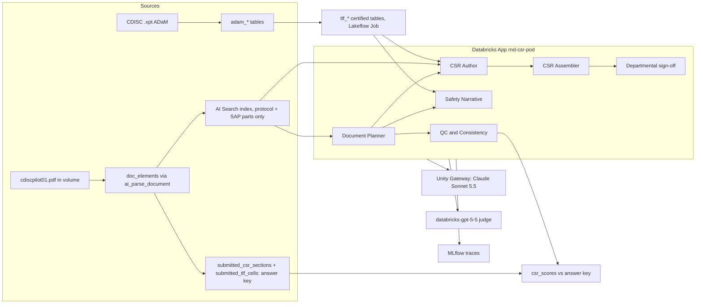

# Demo plan: field (GSK R&D, Elanco, HLS), the CSR Pod on CDISC Pilot 01

Status: APPROVED (22 Oct 2026)
This file is the only input `demo-build` reads. It must make sense without the planning conversation.

## 0. Identity (per demo-hygiene)
| | Value |
|---|---|
| Name | `rnd_csr_pod` |
| Workspace | `fe-vm-sean-zhang` (default), warehouse `16ad82bead3f55b5` |
| Schema | `sean_zhang_catalog.rnd_csr_pod` (checked free on 22 Oct 2026) |
| Tags | `sz_domain=rnd`, `sz_project=csr_pod`, `asset_class=app` |
| Local folder | `~/Projects/gsk/rnd_csr_pod` |
| GitHub | `sean-zhang-dbx/rnd-csr-pod`, private, topics: `domain-rnd`, `account-gsk`, `app`, `demo` |
| App | `rnd-csr-pod` |
| Stack | AppKit (TypeScript/React), Python for data and TLF scripts |
| Engine | The CSR Pod engine from `~/Projects/gsk/rnd_regsub_review/server/lib/pod/` (5 tool-calling agents in the app, Unity Gateway, MLflow tracing), ported and generalised. Sean chose this over the Agent Bricks CLI on 22 Oct 2026: GA components only on the demo path; the README names the Agent Bricks CLI (Beta) as the production route. |

## 1. Problem
- **Customer / audience in the room:** field-ready for Mike Sanky (HLS GTM) to show many customers; first audiences GSK R&D (Jiajie Zhang, VP AI and Data Science) and the Elanco regulatory team.
- **Persona using the screen:** a medical writing lead preparing a CSR draft for internal review, with Biostatistics and Clinical Safety as co-owners.
- **One sentence:** A medical writing team takes weeks to get from final TLFs to a complete, checked CSR draft; this demo drafts the whole CSR of a real public study (CDISC Pilot 01) from an empty template, ties every figure to a certified cell, and scores each section against the CSR that was actually written.
- **Source of the pain:** Jiajie, 20 Oct 2026: "Nobody would be interested in the small subsection of a CSR. Everybody's interested in how to write a whole CSR... end-to-end from an empty template." Also "a lot of the stuff you showed me today GSK is already doing." Time to first draft (about 3 to 4 weeks after final TLFs) is from the EMWA survey cited in `~/Projects/gsk/rnd_regsub_review/docs/PRD_document_drafting.md`; treat it as a planning reference (assumption for this demo).
- **Success metric:** first complete draft of all ICH E3 sections from weeks to about 3 minutes of run time; figures typed by a model: 0; figures matching the submitted CSR's tables: 100% after the re-delivery.
- **Demo length:** 8 minutes.
- **What the customer already does here:** GSK already drafts with LLMs (Jiajie). So the demo does not lead with "a model writes text". It leads with the whole document, figures that cannot disagree with the tables, a score against a real submitted CSR, and departmental accountability.
- **Unit of scope:** the whole CSR (ICH E3 sections 1 to 16). Laboratory and vital signs sections (12.4, 12.5) and their tables (14-6.x, 14-7.x) are marked "not part of this demo" in the template and excluded from the score; the README says how they would extend.
- **Feedback carried from earlier versions:** from the `rnd_regsub_review` CSR Pod (21 to 22 Oct): (a) the data was synthetic and the protocol and SAP were 11 pages, so AI Search had nothing to do (50 of 55 cited passages were pinned in the registry): fixed by real 100-page sources and no pinned passages; (b) the look and shell repeated the 20 Oct app: fixed by a new shell (section 5); (c) the rejected-save moment is not guaranteed: do not script it.

**Data source and terms (must be respected).** CDISC SDTM/ADaM Pilot Project, study CDISCPILOT01 ("Safety and Efficacy of the Xanomeline Transdermal Therapeutic System (TTS) in Patients with Mild to Moderate Alzheimer's Disease"), from https://github.com/cdisc-org/sdtm-adam-pilot-project (path `updated-pilot-submission-package/900172/m5/`). Terms of use (file `CDISC.Pilot Project Data.Website Disclaimer.v1.pdf` in that repo): do not mislead about the origin of the data; do not disassemble, modify or alter any part of the data; do not distribute without attribution to CDISC; do not distribute for a fee. Consequences for the build:
- Load the ADaM `.xpt` files into Delta with the same rows and values. Do not change any value. Derived tables (TLFs) are new tables, never edits of the source.
- Store the CSR package PDF (`cdiscpilot01.pdf`, 492 pages) in the volume as downloaded, unsplit. Parse it whole and tag pages by part (section 4); restrict retrieval by part, never by cutting the file.
- Every screen carries the attribution line in section 5, and the README has a Data section with the source, the terms and a link.
- The re-delivery (beat 4) changes a derivation rule in our TLF code, never the data, and is labelled on screen as a demo scenario.

## 2. Experience
- **Opening screen (last thing first):** the Scorecard. One headline line, then a reconciliation strip with one row per ICH E3 section: figures that match the submitted CSR (n of m), content coverage against the submitted section (judge score 1 to 5), sentences that need a person, and who owns it. All rows quiet except section 12.2, which shows figures that differ from the submitted Table 14-5.01. Presenter: "This CSR was drafted in about 3 minutes from an empty template. The model typed no figure, and almost every figure matches the report that was actually written for this study. One section doesn't. Let me show you how it was made, and why that section is different."

| # | Audience sees | Problem it answers | What Databricks does | Databricks object | Presenter line | Link key |
|---|---|---|---|---|---|---|
| 1 | Sources (1.5 min): the study's ADaM datasets in Unity Catalog, the TLF tables derived from them with lineage, and the protocol and SAP (about 100 pages) parsed into elements and searchable. The answer key (submitted CSR body and section 14) is shown as locked: the pod cannot read it | "Can I trust what it drafted from?" | Unity Catalog holds the analysis data and the certified tables with lineage; `ai_parse_document` turns the PDF into typed elements; AI Search indexes the protocol and SAP | `adam_*` tables, `tlf_*` tables (certified tag, lineage), volume `source_docs`, `doc_elements`, AI Search index `doc_elements_index` | "This is a real public study: the analysis data and the certified tables live in Unity Catalog, and the protocol and SAP are parsed and searchable. The submitted report is locked away from the pod; we only use it to score." | `beat1` |
| 2 | The pod (2 min): the 5-column pod from the pre-run, replayed (Context, Plan, Draft & check in parallel, Assemble, Sign-off). Open the CSR Author Agent: its skill, its tool calls, the AI Search queries it ran and the passages it chose | "Who did what, and how?" | 5 agents call Claude Sonnet 5.5 through a Unity Gateway model service, each with its own tools; every model and tool call is one MLflow trace | Unity Gateway model service `rnd_csr_pod.csr_author`, MLflow experiment, `csr_runs`, `csr_sections` | "A pod is a team running a process. The planner and the author search the protocol and SAP themselves; nobody told them which paragraph to use." | `beat2` |
| 3 | **Hero: Compare (2 min).** Section 11.4.1 (ADAS-Cog primary endpoint) from the pod on the left, the submitted CSR page on the right. A tick column between them lights up figure by figure: each drafted figure, its certified cell, and the printed number in the submitted Table 14-3.01. Then the wording: what the submitted writer said that the pod left to a person | "Would this survive tick and tie?" | SQL filled every figure from the certified cell; the parsed submitted page gives the printed value; a judge on a second model family (GPT 5.5) scores coverage | `tlf_14_3_01_adascog_w24`, `submitted_tlf_cells`, `csr_scores`, judge traces | "The model never saw a number. SQL filled each one from the certified table, and every one matches what was printed in the submitted report. The wording is the model's, and the interpretation is still the writer's." | `beat3` |
| 4 | Re-delivery and sign-off (2 min): back to section 12.2 from the scorecard. Biostatistics re-delivers Table 14-5.01 with a corrected derivation (version 1 counted all adverse events; version 2 counts only treatment-emergent ones, as the SAP says). The pod lists the sentences that quote changed cells, recomputes their figures, redrafts 12.2 live, re-scores: the row turns quiet. Then Medical Writing, Biostatistics and Clinical Safety sign, and Regulatory Affairs can release | "What happens when a table changes, and who signs?" | Delta keeps both table versions; citation records find every affected sentence; the pod redrafts one section; sign-offs are stored with table versions | `tlf_14_5_01_teae` history (v1, v2), `csr_figure_citations`, `csr_signoffs` | "The table changed, the data didn't. The pod knows exactly which sentences quoted it. And nothing is released until the responsible people sign, against the table versions they checked." | `beat4` |

- **Hero moment:** beat 3. Second by second: (0 s) Compare opens on 11.4.1, both pages visible; (2 s) the tick column animates top to bottom, one tick per figure (the only motion in the app), each tick reading "Table 14-3.01, Xanomeline High Dose, LS mean change: drafted -1.2, printed -1.2"; (10 s) the header reads "13 of 13 figures match the submitted CSR" (the number is whatever the data gives); (15 s) hover a figure on the left: it highlights the matching element box on the submitted page image on the right; (30 s) scroll to the "Wording" panel: the judge's coverage score and the 2 to 3 points the submitted writer made that the pod left for a person. Why it matters to this persona: tick and tie of every figure against the TLFs is the slowest QC step; here it is done, against a real submitted report, before anyone opens the draft. It is hard to fake because the reference is a public document anyone can download.
- **Must be true in the data:**
  1. `adam_*` tables reproduce the `.xpt` files exactly (row counts: ADSL 254, ADAE 1191, ADQSADAS 12463, ADQSCIBC 730, ADTTE 254; arms Placebo 86, Xanomeline Low Dose 84, Xanomeline High Dose 84; a checksum per table matches the `.xpt`).
  2. Every cell of `tlf_14_1_01`, `tlf_14_1_02`, `tlf_14_2_01`, `tlf_14_3_01`, `tlf_14_3_02`, `tlf_14_4_01`, `tlf_14_5_02` and `tlf_14_5_01` at version 2 equals the printed value in the submitted section 14 table at the printed precision (checked against `submitted_tlf_cells`). If a printed value cannot be reproduced (for example a SAS-specific rounding), document the cell and exclude it from the score; do not adjust our number to fit.
  3. `tlf_14_5_01_teae` version 1 (all AEs, ignoring `TRTEMFL`) differs from the printed Table 14-5.01 in at least 3 cells that the pre-run draft of 12.2 quotes (ADAE has 65 records with `TRTEMFL = 'N'`). Version 2 (`TRTEMFL = 'Y'`) matches.
  4. The pre-run draft (latest done run) is bound to `tlf_14_5_01_teae` version 1, and its scorecard shows 12.2 as the only section with differing figures.
  5. No passage cited by any drafted sentence has `doc_part` in (`csr_body`, `csr_tlf`) (the pod never read the answer key). Checked by a query.
  6. The submitted body text of 10.1 and 11.2.1 contains the figures the pod drafted for the same cells (independent check on the body text, not just section 14). Every number in the submitted 10.1 text and in the in-text Table 11-1 of 11.2.1 is mapped by hand, in the check script, to its TLF cell; each mapped cell that the pod drafted in sections 10 or 11.2 must carry the same value (about 24 cells), and body numbers with no drafted counterpart are listed, not failed. (Changed with Sean on 22 Oct 2026: the submitted 11.4.1 text quotes no Table 14-3.01 numbers, so the original 11.4.1 wording could not pass.)
- **Fallback if it fails live:** everything except the beat 4 redraft is pre-run and read from tables. If the live redraft fails or runs long, the figures still recompute by SQL instantly (no model) and the scorecard row turns quiet; the presenter says the wording check runs in the background. A recording of the full flow is in `recordings/`.
- **X-ray layer:** markers hidden by default, toggled by `X` (and a small switch). One drawer layout (dark surface): object, status, SQL or code, "See it in Databricks".

| Screen area | Databricks object | Status | Link key |
|---|---|---|---|
| Scorecard strip | `csr_scores`, judge traces | GA | `beat3_scores` |
| Sources: ADaM tables | `adam_adsl` and others, Catalog Explorer | GA | `beat1_adam` |
| Sources: TLF tables | `tlf_*` lineage tab | GA | `beat1_tlf` |
| Sources: documents | volume `source_docs`, `doc_elements` | GA | `beat1_docs` |
| Sources: search | AI Search index `doc_elements_index` | GA | `beat1_search` |
| Pod | MLflow trace of the run | GA | `beat2` |
| Pod: agents | Unity Gateway model service | GA | `beat2_gateway` |
| Compare | `tlf_14_3_01_adascog_w24`, `submitted_tlf_cells` | GA | `beat3` |
| Re-delivery | `tlf_14_5_01_teae` history tab | GA | `beat4` |
| Sign-off | `csr_signoffs` | GA | `beat4_signoffs` |

- **Sample copy (shown to Sean at the gate):**
  - Opening headline: "Drafted in 3 min 04 s from an empty ICH E3 template. 0 figures typed by a model. 212 of 219 figures match the submitted CSR." (numbers from the data)
  - Panel line (Sources): "The submitted report is the answer key. The pod cannot read it."
  - Hero line (Compare): "13 of 13 figures in 11.4.1 match the submitted Table 14-3.01."
  - Re-delivery banner: "Biostatistics re-delivered Table 14-5.01 (version 2: treatment-emergent events only). 6 sentences quote changed cells. Demo scenario: the data is unchanged; version 1 used an incorrect derivation."
- **Cut list:**
  - The LMN-301 synthetic study and the 20 Oct 4-step flow: replaced by real data; stays in `rnd_regsub_review`.
  - Genie Agent tick and tie: the submitted CSR is a stronger, independent reference, and it avoids a second space to curate.
  - Reviewer assistant (chat): not on the storyline.
  - Laboratory and vital signs sections and tables (14-6.x, 14-7.x): large, and not needed for the story; marked "not part of this demo".
  - Module 2 and the label: scope creep.
  - Elanco animal-health variant: separate follow-up.
  - Live full-CSR run on stage: about 3 minutes; pre-run instead, live redraft of one section only.
  - Word export: keep the button (cheap), not a beat.
  - Agent Bricks CLI: production route in the README, not on the demo path.

## 3. Databricks mapping
| Beat | Capability (current name) | Status | Source link |
|---|---|---|---|
| 1 | Unity Catalog tables, certification tag (`system.certification_status`), table lineage | GA | memory `reference_databricks_feature_status_2026_10` (Azure release notes, verified 13 Oct 2026); https://docs.databricks.com/aws/en/data-governance/unity-catalog/ |
| 1 | Unity Catalog volumes | GA | https://docs.databricks.com/aws/en/volumes/ |
| 1 | `ai_parse_document` (typed elements, page images) | GA (no preview label on the function page, checked 22 Oct 2026) | https://docs.databricks.com/aws/en/sql/language-manual/functions/ai_parse_document |
| 1, 2 | AI Search (formerly Vector Search), hybrid queries with filters | GA (renamed June 2026) | memory `reference_databricks_feature_status_2026_10` |
| 2 | Unity Gateway model service (OpenAI-compatible chat completions with tool calling), Claude Sonnet 5.5 | GA since 4 Aug 2026 | same memory; tool calling tested on 21 Oct 2026 through `/ai-gateway/mlflow/v1/chat/completions` |
| 2, 3 | MLflow 3 tracing (Node SDK `mlflow-tracing` in the app) | GA (MLflow tracing); Node SDK status unverified | https://docs.databricks.com/aws/en/mlflow3/genai/tracing/ |
| 3 | Foundation Model API `databricks-gpt-5-5` (judge, second model family) | GA | same memory |
| 1, 3 | SQL warehouse (serverless) for TLF SQL and the app's queries | GA | |
| 1 | Lakeflow Jobs (serverless) running the TLF build script | GA | same memory |
| 4 | Delta table history, `VERSION AS OF`, `RESTORE` | GA | |
| all | Databricks Apps (AppKit) | GA | same memory |
| README only | Agent Bricks CLI (production route for the agents) | Beta (29 Sep 2026) | same memory |

Diagram:


## 4. Contract
**Data model** (all in `sean_zhang_catalog.rnd_csr_pod`, tags from section 0 plus `source=cdisc_pilot01` on source-derived tables; every table comment ends with "Source: CDISC SDTM/ADaM Pilot Project (CDISCPILOT01), used under the CDISC terms of use.")

| Table | Columns (name type) | Rows | Notes |
|---|---|---|---|
| `adam_adsl`, `adam_adae`, `adam_adqsadas`, `adam_adqscibc`, `adam_adtte` | the `.xpt` columns as they are (names as in the file), SAS dates converted to DATE | 254, 1191, 12463, 730, 254 | Values unchanged. Loaded with pandas `read_sas(format='xport')` then Spark. Checksum per table recorded in `RESOURCES.md`. |
| `tlf_14_1_01_populations` | row_key STRING, row_label STRING, row_order INT, pbo_n INT, low_n INT, high_n INT, total_n INT | about 4 | ITT, Safety, Efficacy, Completers Week 24 |
| `tlf_14_1_02_disposition` | row_key, row_label, row_order, pbo_n INT, pbo_pct DOUBLE, low_n, low_pct, high_n, high_pct, total_n, total_pct | about 12 | completed, discontinued by reason (from `DCDECOD`) |
| `tlf_14_2_01_demographics` | row_key, row_label, row_order, pbo DOUBLE, pbo_pct DOUBLE, low, low_pct, high, high_pct, total, total_pct, p_value DOUBLE | about 25 | age, age group, sex, race, MMSE, duration of disease, education, BMI, as printed |
| `tlf_14_3_01_adascog_w24` | row_key, row_label, row_order, pbo DOUBLE, low DOUBLE, high DOUBLE, p_value DOUBLE | about 15 | ADAS-Cog (11) change from baseline to Week 24, LOCF, efficacy population: n, baseline mean and SD, Week 24 mean and SD, change mean and SD, ANCOVA dose-response p, LS means, differences vs placebo with SE, 95% CI and p, as in the submitted table (ANCOVA with site group and baseline; method from the SAP; Python statsmodels in the TLF job) |
| `tlf_14_3_02_cibic_w24` | same shape as 14-3.01 | about 10 | CIBIC+ at Week 24, LOCF |
| `tlf_14_4_01_exposure` | row_key, row_label, row_order, pbo, low, high, total DOUBLE | about 8 | |
| `tlf_14_5_01_teae` | row_key, row_label, row_order, pbo_n INT, pbo_pct DOUBLE, low_n, low_pct, high_n, high_pct, total_n, total_pct | about 250 | ANY row first, then SOC and PT rows. **Version 1:** all ADAE records (demo error). **Version 2:** `TRTEMFL = 'Y'` only (matches the submitted table). Built by `scripts/tlf_build.py --teae-rule v1|v2` |
| `tlf_14_5_02_sae` | same as 14-5.01 | about 5 | serious TEAEs |
| `study_metadata` | meta_key STRING, meta_value STRING, value_type STRING | about 20 | title, phase, product, indication, sites, countries, dates, all from the CSR title page and ADSL; number-valued keys become placeholders |
| `narrative_patients` | row_key STRING (USUBJID), arm, age INT, sex, aedecod, aesoc, astdy INT, aendy INT, aeout, aeacn, aerel, trtdur INT, narrative_reason | 3 to 8 | deaths (`ADSL.DTHFL`) and serious AEs (`ADAE.AESER = 'Y'`) |
| `doc_elements` | file_path STRING, doc_title STRING, doc_part STRING, page INT, element_id INT, element_type STRING, content STRING, x0 DOUBLE, y0 DOUBLE, x1 DOUBLE, y1 DOUBLE, confidence DOUBLE | about 8,000 | from `ai_parse_document` on the whole PDF. `doc_part` by page range: `csr_body` (1 to 41), `csr_tlf` (42 to 151), `references` (152), `appendix_index` (153 to 156), `protocol` (about 157 to 215), `protocol_appendix` (about 216 to 415), `sap` (about 416 to 464), `other` (rest). The backend confirms the exact ranges from the headings (protocol "1 Introduction" at p158, SAP "1 BACKGROUND" at p421, "Statistical Analysis Plan" title at p416 to 417) and records them in `RESOURCES.md` |
| `doc_pages` | file_path, page INT, image_path STRING, width DOUBLE, height DOUBLE | 492 | page images in volume `parsed_pages` |
| `doc_chunks` + AI Search index `doc_elements_index` | chunk_id STRING, doc_part STRING, page INT, element_ids STRING, chunk_text STRING | about 2,000 | element-level chunks (merge short elements to about 600 characters); Delta Sync, hybrid; endpoint `sz-shared-vs` |
| `submitted_csr_sections` | section STRING, title STRING, page_from INT, page_to INT, text STRING | about 40 | answer key, from `doc_part = 'csr_body'` |
| `submitted_tlf_cells` | tlf STRING, row_key STRING, column_name STRING, printed_value STRING, page INT, element_id INT | about 800 | answer key: printed numbers of the section 14 tables in scope, mapped to our `row_key` and column. Built by a mapping script over the parsed table HTML; unmatched cells listed in the report |
| `section_registry` | section, title, ord INT, kind (`assembled`, `boilerplate`, `drafted`, `narrative`, `not_in_demo`), agent, department, wave INT, instructions STRING, search_hints STRING (JSON array of plain-language topics, **not** passages), tlf_tables STRING (JSON), depends_on STRING (JSON), required_content STRING (JSON) | about 30 | the empty ICH E3 template. No pinned passages: the planner finds them with AI Search |
| `csr_runs`, `csr_sections`, `csr_figure_citations`, `csr_signoffs` | as in `rnd_regsub_review/docs/CSR_POD_BUILD.md` section 3, with `csr_runs.efficacy_version` replaced by `table_versions_json STRING` | | |
| `csr_scores` | run_id STRING, section STRING, figures_total INT, figures_matched INT, mismatches_json STRING, coverage_score INT, coverage_notes STRING, left_for_person_json STRING, judge_model STRING, trace_id STRING, scored_at TIMESTAMP | 1 per drafted section per run | |

**Routes** (Express, JSON; the engine routes keep the shapes of `rnd_regsub_review` `CSR_POD_BUILD.md` section 3.1 unless listed)

| Key | Used by beat | Request, response |
|---|---|---|
| `GET /api/scorecard?run_id=` (default latest done) | opening | `{ run, headline: { wall_ms, figures_total, figures_matched, typed_figures: 0 }, rows: [{ section, title, department, figures_total, figures_matched, coverage_score, needs_person, status: 'quiet' or 'differs' }] }` |
| `GET /api/sources` | 1 | `{ adam: [{ table, rows, columns, checksum_ok }], tlfs: [{ table, tlf, version, certified, upstreams: [] }], docs: { file, pages, parts: [{ doc_part, page_from, page_to, elements, searchable: bool }] }, index: { name, chunks } }` |
| `GET /api/csr/pod`, `GET /api/csr/registry`, `POST /api/csr-run`, `GET /api/csr-run/:id/events`, `GET /api/csr-run/latest`, `GET /api/csr-run/active`, `GET /api/csr-run/:id`, `GET /api/csr-run/:id/export.doc` | 2 | as in `rnd_regsub_review` |
| `GET /api/compare?run_id=&section=` | 3 | `{ section, drafted: Sentence[], submitted: { pages: [{ page, image_path, width, height, elements: [{ element_id, element_type, x0, y0, x1, y1, content }] }], text }, ticks: [{ sentence_idx, slot, drafted_value, tlf, row_key, column_name, table_version, printed_value, printed_page, printed_element_id, match: bool }], wording: { coverage_score, notes, left_for_person: string[] } }` |
| `GET /api/page-image?path=` | 3 | page image from volume `parsed_pages` |
| `POST /api/redeliver` body `{ table: 'tlf_14_5_01_teae' }` | 4 | runs the version 2 build SQL on the warehouse, then starts a redraft run for the sections that quote changed cells. `{ old_version, new_version, changed_cells, affected: [{ section, sentence_idx, slot, old_value, new_value }], run_id }` |
| `GET /api/csr/signoffs`, `POST /api/csr/signoff` | 4 | as in `rnd_regsub_review` |

**Engine changes from `rnd_regsub_review` (backend):**
- Study context, people and skills read the study from `study_metadata`, not the hard-coded LMN-301 text.
- `find_passages` (planner) and `search_documents` (author) query AI Search with filter `doc_part IN ('protocol', 'sap')`; the registry has `search_hints`, never passages. The code refuses any cited element whose `doc_part` starts with `csr_`.
- `tick_and_tie` compares bound cells with `submitted_tlf_cells` instead of a Genie Agent, and writes `csr_scores`; `judge_section` also scores coverage against `submitted_csr_sections` (GPT 5.5), but the judge's view of the answer key is only used for scoring, never fed back to the author.
- Table versions are recorded per table per run (`table_versions_json`), not a fixed efficacy version.
- Model service: create `sean_zhang_catalog.rnd_csr_pod.csr_author` (Unity Gateway, routes to `databricks-claude-sonnet-5-5`, inference table on). The app SP needs EXECUTE on it.

**Links:** `config/demo-links.json` keys: `beat1`, `beat1_adam`, `beat1_tlf`, `beat1_docs`, `beat1_search`, `beat2`, `beat2_gateway`, `beat3`, `beat3_scores`, `beat4`, `beat4_signoffs`, `app` (backend writes URLs per `demo-ux/references/databricks-links.md`, frontend reads them).

## 5. UI direction
**Setting.** A medical writing lead at a desk with a large monitor, reconciling a draft against the tables before internal review; on stage, the same screen projected for a room of R&D and regulatory leaders. Pressure: every number must be defensible, and the room should see the answer in 5 seconds.

**Tokens** (must differ from `rnd_regsub_review`: no navy bar, no Public Sans or Source Serif, no Vault three-pane as the shell).
| Role | Value |
|---|---|
| Background | `#EDF1EF` (cool grey-green) |
| Surface (pages, panels) | `#FFFFFF` |
| Text | `#17201D` |
| Muted text | `#5E6B66` |
| Accent (pod, interactive controls, bound-figure tint `#EEE6F4`) | `#5A2E7A` (aubergine) |
| Status: matches the submitted CSR | `#1E7A4C` |
| Status: differs | `#B0451C` |
| X-ray drawer surface | `#17201D`, text `#E8EEEB` |

- Type: **Instrument Sans** (UI and the drafted document), **Spline Sans Mono** with tabular figures for numbers, IDs and table cells only (never as decoration). Both from Google Fonts via `@fontsource`.
- Radius: 6px panels, 4px controls. Shadow: none on panels (1px `#D6DDDA` border), one soft shadow only on the two compared pages.

**Shell.** A thin top line (study identity: "CDISCPILOT01, Xanomeline TTS in mild to moderate Alzheimer's disease" and the run time) and a narrow left rail with 5 text stops, no icons: Scorecard, Sources, Pod, Compare, Re-delivery and sign-off. The active stop has an aubergine bar. A footer line on every screen: "Data: CDISC SDTM/ADaM Pilot Project (CDISCPILOT01), used under the CDISC terms of use. The drafted report is produced by this demo; the submitted report is shown for comparison."

**Wireframes.**
```
Opening: Scorecard
+--------------------------------------------------------------------------------+
| CDISCPILOT01  Xanomeline TTS in mild to moderate Alzheimer's      run 3 min 04 s |
+-----------+--------------------------------------------------------------------+
| Scorecard | Drafted in 3 min 04 s from an empty ICH E3 template.               |
| Sources   | 0 figures typed by a model.  212 of 219 figures match the          |
| Pod       | submitted CSR.                                                     |
| Compare   |                                                                    |
| Re-deliv. | Section                    Figures match   Coverage  Person  Owner |
|           | 10   Study patients        ||||||||| 18/18   4 of 5    1       BS   |
|           | 11.4.1 ADAS-Cog primary    ||||||||| 13/13   4 of 5    2       BS   |
|           | 12.2 Adverse events        ||||||-   14/20   4 of 5    0       CS   |  <- rust, the only loud row
|           | ...                                                                |
+-----------+--------------------------------------------------------------------+
| Data: CDISC SDTM/ADaM Pilot Project (CDISCPILOT01) ...                          |

Hero: Compare
+-----------+--------------------------+----+-----------------------------------+
| rail      | Drafted by the CSR Pod   | ticks| Submitted CSR, p 27 (parsed page) |
|           | 11.4.1 Primary endpoint  |  v | [page image with element boxes]   |
|           | ...figures tinted...     |  v |                                   |
|           |                          |  v |                                   |
|           | Wording: coverage 4 of 5. Left for a person: ...                 |
+-----------+--------------------------+----+-----------------------------------+
```
The Pod screen reuses the pod layout from `rnd_regsub_review/client/src/components/csr/PodFlow.tsx` restyled in these tokens (sentence-case column labels, no uppercase eyebrows).

**Three principles.**
1. The submitted CSR is the reference: every drafted figure sits next to its printed counterpart; agreement is quiet ink with a small tick, and disagreement is the only loud colour on the page.
2. Provenance over decoration: a figure's table, row, column and version are one hover away; no badges, no sparkles.
3. One accent, aubergine, for the pod and the controls; green and rust only mean "matches" and "differs".

**Blacklist check** (`demo-ui/references/slop-blacklist.md`): 1 cream/serif/terracotta: no (cool grey, sans, rust only as a status). 2 dark with acid accent: no. 3 broadsheet: no (panels with radius, no hairline columns). 4 card grid: no (one strip and two pages). 5 template chrome: removed uppercase pod column labels from the old build; mono only for figures. 6 shadcn default: custom tokens and fonts. 7 KPI card row: replaced by one headline sentence and the strip. 8 icon sidebar: text-only rail with 5 stops, which are real screens. 9 to 11: none. 12 motion only on the hero tick column. 13 the rail is a sequence (the demo order), so numbering is not used. 14 numbers come from the data. 15 no marketing lines. 16 the scorecard has one loud row.

## 6. Tasks
### demo-backend (owns `config/`, `server/`, `scripts/`, `databricks.yml`, `app.yaml`, workspace objects)
1. Scaffold the AppKit app (`databricks apps init` per `databricks:databricks-apps`), bundle `rnd-csr-pod`, schema variable `rnd_csr_pod`. Create the schema with tags, volumes `source_docs` and `parsed_pages`.
2. `scripts/load_adam.py`: download the 5 ADaM `.xpt` files and `cdiscpilot01.pdf` from the CDISC repo into a new, empty folder (untrusted data; run Python with `-I`), upload the PDF unchanged to `source_docs`, load the ADaM tables unchanged, record checksums. Must-be-true 1.
3. `scripts/parse_docs.py`: `ai_parse_document` on the whole PDF (version 2.0, page images to `parsed_pages`), write `doc_elements` and `doc_pages`, set `doc_part` by page range (confirm ranges from headings), build `doc_chunks` and the AI Search index with `doc_part` as a filterable column.
4. `scripts/tlf_build.py` (also registered as a Lakeflow Job "CSR Pod: TLF build"): build the 8 TLF tables from `adam_*` (SQL CTAS where possible so lineage exists; statsmodels ANCOVA for 14-3.01 and 14-3.02, method from the SAP), certification tag, column comments. 14-5.01 at version 1 first, then keep the version 2 SQL in `config/redeliver_14_5_01.sql`.
5. `scripts/build_answer_key.py`: `submitted_csr_sections` and `submitted_tlf_cells` from the parsed `csr_body` and `csr_tlf` parts; then `scripts/check_tlfs.py` compares every in-scope TLF cell with the printed value (must-be-true 2 and 3) and prints a report. Fix our derivations until they match; never edit printed values; document unreproducible cells.
6. `study_metadata`, `narrative_patients`, `section_registry` (empty ICH E3 template, search hints, no passages), engine tables, `csr_scores`.
7. Port the engine from `~/Projects/gsk/rnd_regsub_review/server/lib/pod/` and its routes with the changes in section 4; add `/api/scorecard`, `/api/sources`, `/api/compare`, `/api/redeliver`. Create the Unity Gateway model service; grants script for the app SP.
8. Run a full CSR, pre-run with 14-5.01 at version 1, check must-be-true 4 to 6 with `scripts/check_must_be_true.py`. `scripts/reset_demo.py`: delete `csr_signoffs`, `RESTORE TABLE tlf_14_5_01_teae` to the version 1 version, mark any run after the pre-run as superseded so the pre-run is the latest.
9. Write `config/demo-links.json`.
Reports: files, row counts and checksums, the TLF match report (cells matched, unmatched with reasons), must-be-true results, page ranges per `doc_part`, link URLs, the pre-run id and its scorecard.

### demo-frontend (owns `client/`)
1. Theme from section 5 (tokens into the shadcn variables, fonts via `@fontsource`), shell (top line, rail, footer attribution).
2. Screens in beat order against typed fixtures until the routes exist: Scorecard, Sources, Pod (port and restyle `PodFlow`, `AgentDrawer` from `rnd_regsub_review`), Compare (hero, with the only animation), Re-delivery and sign-off (port `Accountability`).
3. X-ray layer: markers, one dark drawer layout, "See it in Databricks" links from `config/demo-links.json`, toggled by `X`.
4. Loading, empty and error states; the re-delivery button disables while a run is active.
Reports: screens built, anything still on fixtures, anything in section 5 not applied, screenshots at 1440x900 and 1920x1080.

## 7. Definition of done
- [ ] Every beat works in order, live, against the workspace.
- [ ] Hero moment lands with the real data (must-be-true 1 to 6 pass).
- [ ] Every link opens the right object.
- [ ] Reviewer: UX scores all 4 or higher, then UI scores all 4 or higher (or gaps reported).
- [ ] The click-through script clicks every screen, drawer, chip and button with no failures, and the demo is reset afterwards.
- [ ] After deploy: live smoke test passes against the deployed URL.
- [ ] README lists every Databricks feature used with its status, and has the CDISC data section (source, terms, attribution).
- [ ] `docs/FEEDBACK.md` created, with items (a) to (c) from section 1 marked `built`.

## 8. Verification
- Data: `uv run --python 3.12 --with databricks-sql-connector python scripts/check_tlfs.py` (TLF match report) and `scripts/check_must_be_true.py` (prints PASS or FAIL per statement in section 2).
- Types: `npm run typegen` (or `pnpm typegen`), `pnpm typecheck`, `npx eslint <changed files>`, `pnpm build`.
- Local: `pnpm dev` on http://localhost:8000.
- Click-through: `tools/ui_runthrough.py` (Playwright, chromium): every rail stop, the pod drawers, the Compare hover, the re-delivery (then reset), each Sign button (then reset).
- Reset: `uv run --python 3.12 --with databricks-sql-connector python scripts/reset_demo.py`.
- Reviewer: dispatch `demo-ui-reviewer` with http://localhost:8000 and this file.
- Deploy: `databricks bundle deploy -p fe-vm-sean-zhang && databricks bundle run app -p fe-vm-sean-zhang`, then curl each route with `Authorization: Bearer $(databricks auth token -p fe-vm-sean-zhang ...)` against the app URL.
