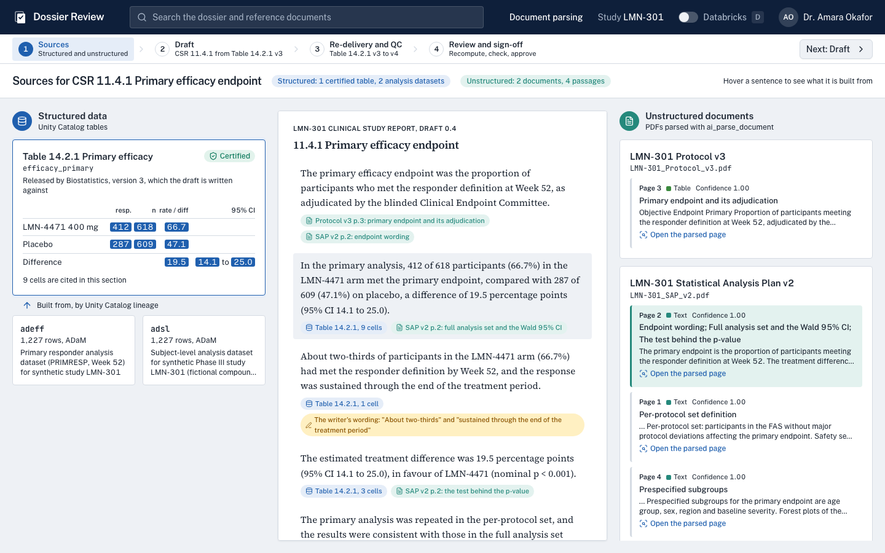
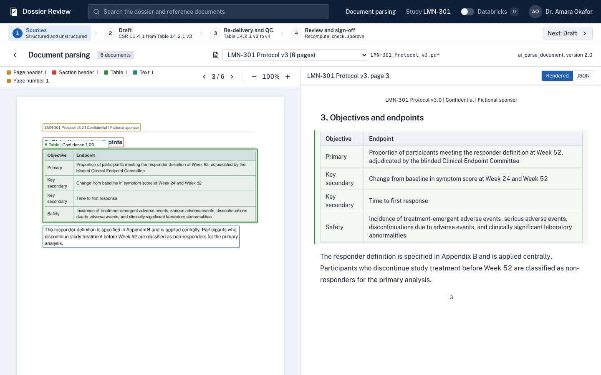
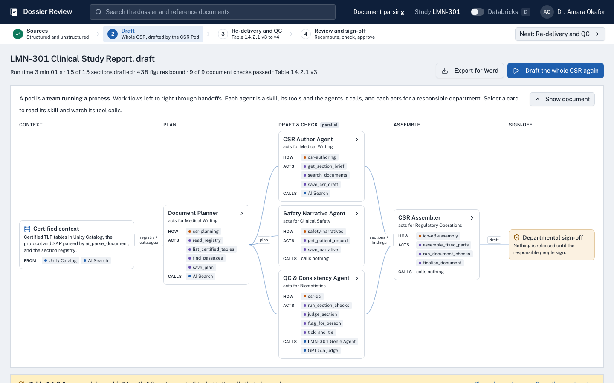
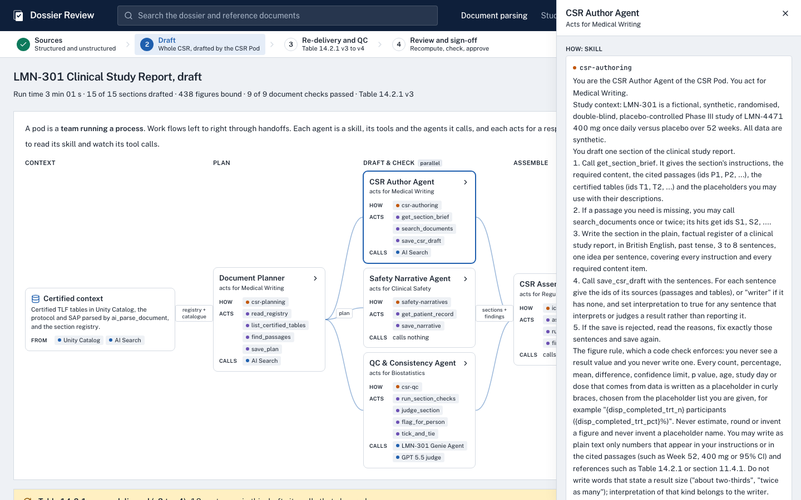
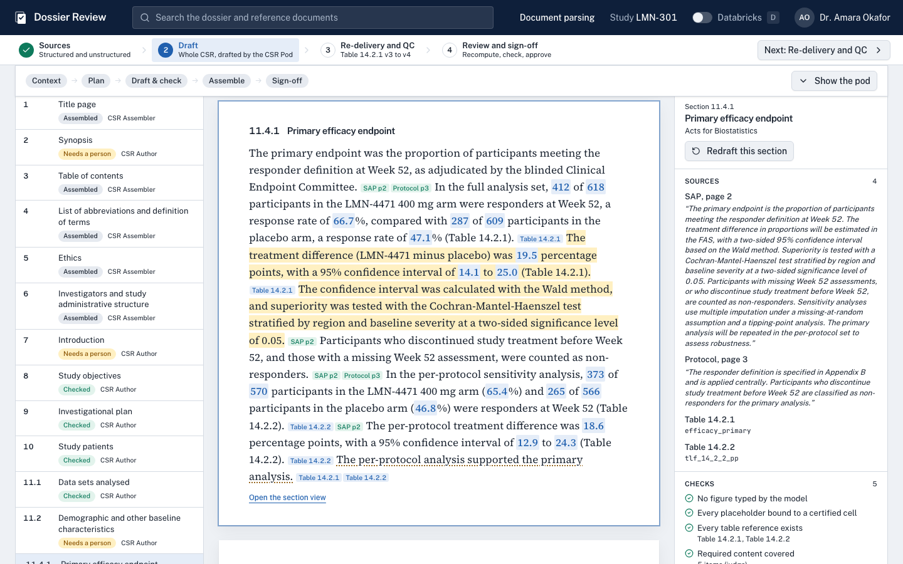
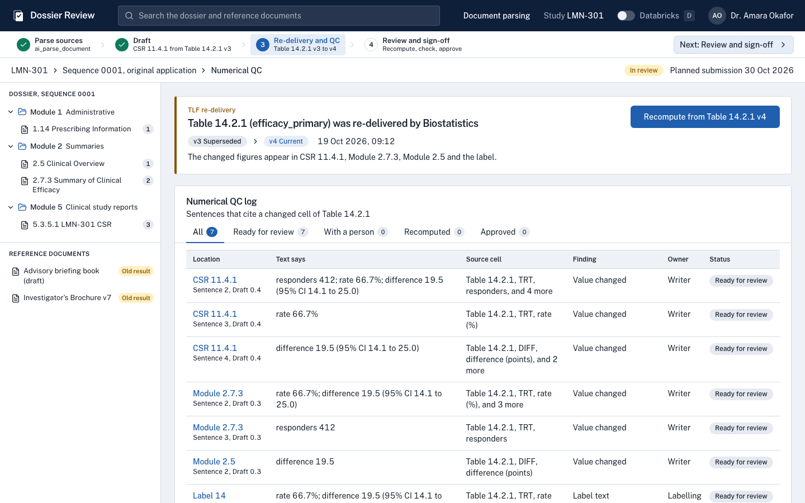
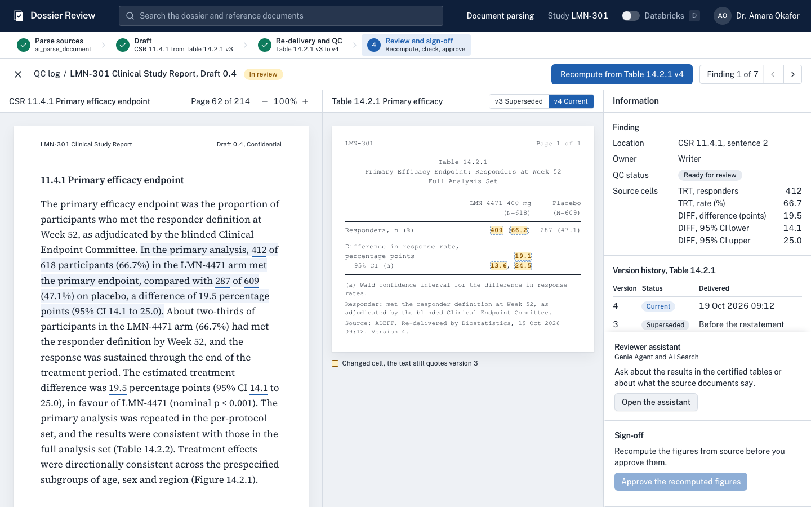

# Script: AI for regulatory submission

Jiajie Zhang call, Tuesday 20 October 2026, 14:00 UK. Sean's section follows Mike Sanky's on clinical operations.

Jiajie is VP of AI/ML for R&D and previously led AI/ML at Sanofi R&D and Evinova, so the script stays out of regulatory basics and keeps the depth for questions. All data in the demo is synthetic, for the fictional study LMN-301.

**Timing: about 14 and a half minutes.** Slides 1 to 6 take about 4 minutes, the demo about 8 and a half (in 4 workflow steps, each told, shown and told), and slides 7 to 9 about 2. If you are running long, use "If time is short" near the end.

Deck: https://docs.google.com/presentation/d/1NIuGc-eNnNr-bg7R1YbyLrsfTo9Lg75xaeHAVkOKkGQ/edit
App: https://rnd-regsub-review-7474654216647582.aws.databricksapps.com

---

## Before the call

Earlier in the day:

1. Rehearse once in the app, including "Draft this section", "Recompute" and the assistant.
   On `/csr`, check that the pre-run draft loads (9 of 9 document checks). A rehearsal "Draft the whole CSR" is fine; the newest finished run is the one shown.
2. Score the rehearsal traces, so judged traces are ready for the end of the demo:
   ```bash
   cd ~/Projects/gsk/rnd_regsub_review && uv run --python 3.12 --with "mlflow[databricks]>=3.5" --with databricks-sql-connector python scripts/judge_traces.py
   ```

10 minutes before:

1. Reset the demo (this clears `review_signoffs` and `csr_signoffs`, and keeps the CSR draft):
   ```bash
   cd ~/Projects/gsk/rnd_regsub_review && uv run --python 3.12 --with databricks-sql-connector python scripts/reset_demo.py
   ```
2. Open the app in a window about 1440 pixels wide and wait for the QC log to load. This warms the SQL warehouse. Then click "1 Sources" so the demo starts there.
3. Check that the "Databricks" switch in the top bar is off and the browser zoom is 100%.
4. Open the deck in presenter view, and keep `docs/screenshots/vault/` open as the fallback.

---

## Slide 1: section divider (15 seconds)

**Say:** "Thanks, Mike. Clinical operations takes a study to database lock, and from there the results have to become the CSR, the Module 2 summaries and the label. I'd like to spend the next few minutes on that part, and in particular on what happens after the first draft is written. I'll show it on a fictional study and leave time for your questions."

## Slide 2: scope (30 seconds)

**Say:** "Before the detail, a word on scope. A product goes to regulators many times, from the first trial application, through the marketing application and the agency's questions, to label updates and periodic safety reports after approval, and each of those submissions has its own documents. Today I'll stay with the clinical study report. It's the largest document built straight from the analysis tables, and its figures are repeated in the Module 2 summaries and in the label, which is why a change to one table reaches several documents."

If Jiajie asks about other documents: the same approach applies wherever a document quotes analysis outputs, for example the Module 2 summaries, the DSUR and PBRER, which are rewritten every reporting period on new data, and the stability sections of Module 3.

## Slide 3: published results (45 seconds)

**Say:** "You've probably seen some of these. Pfizer published a PK CSR generator in June that drafts a section in about 18 minutes, and their reviewers scored the drafts at about 90% of expert quality. Merck reports that a fully reviewed first draft now takes about 80 hours instead of 180, and Novo Nordisk reports CSR first drafts in minutes. In each of these programmes experts still check the draft against the analysis tables before it's approved, and I think that check is now where most of the remaining time goes."

Background, if asked: the Pfizer figures come from the paper (Clinical and Translational Science, June 2026). Merck's are company-reported in a June 2025 press release. Novo Nordisk's come from an Anthropic customer story.

## Slide 4: where errors come from (45 seconds)

**Say:** "When a generated draft is wrong, the problem usually sits with the data, the model or the interpretation. A figure may not match its certified table, or the table may have changed after the text was written. A new model version or prompt may behave differently from the one that was tested. Or the figures are right and the wording reads the result unfairly. Software can check the first two, so we think the platform should take most of that work off the reviewer's desk, and leave their time for interpretation, which needs a medical writer's judgement."

Keep in reserve, and use it only if Jiajie raises authoring maturity: a June 2026 paper by authors from 8 companies, GSK among them, treats structured authoring as the step before automation.

## Slide 5: the drafting approach (45 seconds)

**Say:** "In Pfizer's published design the model reads the tables and writes the numbers itself, so someone has to check each figure afterwards. Here a workflow drafts the section in 5 steps. It reads the protocol and the SAP, which ai_parse_document has already turned into elements with their place on the page, and it finds the certified table in Unity Catalog. The model then writes the text with a placeholder for each figure, SQL fills the placeholders and records the cell behind each one, and a code check and a judge check the result. I'll run it live in a moment."

## Slide 6: the platform (45 seconds)

**Say:** "Here's how the demo maps onto Databricks, in the 4 steps you'll see across the top of the app. The sources are of 2 kinds: Unity Catalog tables, where Table 14.2.1 is certified by Biostatistics with lineage back to the analysis datasets, and the protocol and the SAP, which ai_parse_document turns into elements with their place on the page. The draft is written by a fixed model version through Unity Gateway, and SQL fills every figure from a certified cell. When a table is re-delivered, Delta keeps both versions and the citation records find each sentence that quoted a changed cell. The reviewer then works in a Databricks App, asking a Genie Agent about the tables and AI Search about the documents, and signs off. MLflow traces every model call, and Unity Catalog governs all of it. What I'd ask you to watch for in each step is where the reviewer's time goes."

Switch to the app.

---

## Demo

The demo follows the workflow bar across the top of the app: **1 Sources, 2 Draft, 3 Re-delivery and QC, 4 Review and sign-off**. "Next" at the right of the bar moves to the following step.

Each step follows tell, show, tell. **Tell first** says what you're about to show and why it matters to Jiajie, the **Do** and **Say** lines are the show, and **Tell after** says what it changed. Keep each tell to 1 or 2 sentences, so the steps stay short.

### Step 1. Sources (1 minute 15 seconds)


*Step 1: the sources of CSR 11.4.1, structured on the left and unstructured on the right, with sentence 2 hovered.*

**Tell first:** "The first question anyone asks about a sentence in a CSR is where it came from, so I'll start with the sources, and you'll see that the answer is both structured data and documents."

**Do:** click "1 Sources" in the workflow bar. "Sources for CSR 11.4.1" opens in 3 columns: structured data on the left, the section in the middle, and the parsed documents on the right. Hover the second sentence, "In the primary analysis…".

**Say:** "A CSR section is put together from 2 kinds of source. On the left is structured data in Unity Catalog: Table 14.2.1, certified by Biostatistics, and, through lineage, the 2 analysis datasets it's built from. On the right are documents, the protocol and the SAP, which ai_parse_document has parsed. When I hover a sentence you can see what it draws on. This one takes its 9 figures from cells of the certified table and its method from the SAP."

**Do:** hover the first sentence. The Protocol page 3 table and the SAP page 2 passage light up. Then click "Open the parsed page" under the Protocol passage.


*Step 1, continued: the Protocol page 3 opened from the Sources page, with the endpoints table outlined.*

**Say:** "This is the page as ai_parse_document sees it: each element with its type, its place on the page and a confidence score, and the content as text and tables. The endpoint table came through as a table, so the draft can quote the endpoint from it."

**If there is time:** in the document picker, choose the advisory briefing book, go to page 9 and hover the chart. "It handles figures too. It recognised this as a bar chart, described it, and read the values off it, 66.7 and 47.1."

**Tell after:** "So every sentence in this section traces to a certified cell or a parsed passage, and anything with no source, like 'about two-thirds', is visibly the writer's. The rest of the demo depends on that."

### Step 2. Draft the whole CSR (2 minutes)


*Step 2: the CSR Pod on /csr, with the draft prepared before the call.*

**Tell first:** "On the last call you asked how we would write a whole CSR from an empty template. This is the whole CSR, drafted by a pod: a small team of agents that runs the process the way your departments do, where each agent acts for a responsible department."

**Do:** click "Next: Draft". The CSR page opens with the draft that was run before the call; the header shows the run time, the figures bound and "9 of 9 document checks passed". Move left to right along the pod.

**Say:** "The context is what Biostatistics already certifies in Unity Catalog, plus the protocol and SAP parsed by ai_parse_document. The Document Planner turns the company template, which is a table, into a plan. Then 3 agents work in parallel: the CSR Author drafts each section, the Safety Narrative Agent writes one narrative per death or serious event, and the QC agent checks every section as it lands. The Assembler puts together the parts that are never written, such as the title page, the contents and the section 14 tables."

**Do:** click the CSR Author Agent card. The drawer shows its skill under HOW and its tool calls below.

**Say:** "Each agent is a skill, its tools and what it calls. The rule in this skill is the one we showed last time: the model never sees a figure and never types one. Its save tool is a code check, so if it types a number, the save is refused and it has to rewrite the sentence with a placeholder."

If the tool log shows a rejected save (amber), point to it and to the corrected save below it. Do not promise one; it depends on the run.


*The CSR Author Agent drawer: the skill (HOW) and the tool calls.*

**Do:** close the drawer and click "Show document". Section 11.4.1 opens. Hover a blue figure to see its table, row, column and version, then point to "Needs a person" on the right.

**Say:** "Every one of these figures was filled by SQL from a certified cell, and the QC agent lists the sentences that need a person, mostly where a sentence interprets a result. The synopsis can only use figures the body already uses, so it can't disagree with the body."


*Section 11.4.1 in the whole draft, with figures bound to cells and the review panel.*

**Do:** scroll down to "Accountability & sign-off".

**Say:** "Delegating the work doesn't remove a department's oversight. Medical Writing, Biostatistics and Clinical Safety each sign their part against the table versions the figures came from, and Regulatory Affairs can't release the CSR until all 3 have signed."

**Tell after:** "About half of a CSR is assembled rather than written, and the rest is drafted from passages and certified cells, so the writer starts from a complete draft with a short list of sentences that need judgement. The banner at the top already shows what happens next: Table 14.2.1 was re-delivered, and the draft knows which sentences quote the changed cells."

**If asked to see it run:** click "Redraft this section" on 12.2 (about 1 minute 45 seconds) and keep talking; the pod cards light up and the tool log fills in. "Draft the whole CSR" takes about 3 minutes, so only start it if there is time, and the new run replaces the draft on screen.

**If asked about the single-section view:** in section 11.4.1 click "Open the section view" for the 5-step drafting workflow from the last call.

Wording to avoid here: "the AI wrote the CSR" (the pod drafts and checks, people interpret and sign) and "validated e-signature" (these are named approvers in governed tables, which the customer validates).

### Step 3. Re-delivery and QC (1 minute)


*Step 3: the re-delivery card and 7 sentences ready for review.*

**Tell first:** "Now the problem from slide 4: the table changes after the text was written. Watch how quickly we find everything the change touched."

**Do:** click "Next: Re-delivery and QC". The QC log opens with the re-delivery card for Table 14.2.1 (v3 Superseded, v4 Current), the dossier tree with a count on each affected document, and the QC log.

**Say:** "Then Biostatistics re-delivers the primary efficacy table after a late data correction. 3 participants in the treatment arm are no longer counted as responders, so 412 of 618 becomes 409, and the difference from placebo goes from 19.5 to 19.1 points. Because each figure was tied to its cell when it was drafted, the reviewer can see each sentence that quotes a changed cell, across the CSR, Module 2.7.3, Module 2.5 and the label, before anyone opens a document."

**If asked what changed in the table itself:** press `D`, then click "What changed, v3 to v4" under the re-delivery card. A saved query opens in the Databricks SQL editor; run it. Delta time travel compares version 3 with version 4 and returns the 5 cells that changed: responders 412 to 409, rate 66.7 to 66.2, difference 19.5 to 19.1, and the CI bounds 14.1 to 13.6 and 25.0 to 24.5. Press `D` again before you go back to the app.

"The table history in Unity Catalog shows that version 4 was written by Biostatistics and when. This query shows the cells that changed, straight from the 2 versions of the table. In production you'd also turn on Change Data Feed, so each re-delivery records its before and after rows."

**Do:** scroll to "Reference documents outside the dossier".

**Say:** "The Investigator's Brochure and the briefing book were written outside this workflow, so they have no citation records. AI Search finds the old result in their parsed text, on page 4 and page 6, and the app notifies their owners without editing either document. The chart we saw a minute ago is in the same briefing book."

**Optional:** click "Open the parsed page" under the briefing book row to show page 6 with 412 highlighted, then press the back arrow.

**Tell after:** "Without the citation records, someone would reread 4 documents looking for 412. Here the list was ready before anyone opened a document, and it includes the 2 documents outside the dossier."

### Step 4. Review and sign-off (2 minutes 45 seconds)


*Step 4 before Recompute: yellow cells changed in version 4, and the text still quotes version 3.*

**Tell first:** "Last, the review. Once the mechanical checks are done, I want to show where the reviewer's time actually goes."

**Do:** click "Next: Review and sign-off". The CSR page opens next to the Table 14.2.1 output. Hover "412" in the text.

**Say:** "This is the tick and tie a QC reviewer already does, with each figure tied to its cell. The yellow cells are the ones that changed, and the text still quotes version 3."

**Do:** click "Recompute from Table 14.2.1 v4". The figures flip on the page, the yellow cells turn green, and after a few seconds the "about two-thirds" sentence turns amber with "With the writer". Hover the amber tag to show the reason.

**Say:** "SQL recomputed the figures from the released table, so no number was retyped. A model then read each updated sentence against its new figures, and it flagged the one whose wording may no longer hold, because 66.2% is below two-thirds. The writer decides what to do with it. The label sentence went to Labelling, because label text has its own review."

**Do:** in the Information panel, click "Open the assistant", then the first suggested question. It takes about 20 seconds; say the line below while it runs. The answer gives 409 of 618 (66.2%) from the Genie Agent with the SQL, and notes that the brochure and the briefing book still quote 412 of 618.

**Say:** "The reviewer can ask in plain language. For figures, the assistant asks a Genie Agent over the certified tables and shows the SQL it ran. For anything the documents say, it searches the parsed PDFs with AI Search and cites the page, and here it did both."

**If there is time:** click the second suggestion, about missing Week 52 assessments, then citation 1. The SAP page opens with the cited passage outlined.

**Do:** close the assistant with the X, then click "Approve the recomputed figures".

**Say:** "The sign-off is stored with a name, a time and the table version it was approved against."

**Do:** close the viewer with the X. The QC log shows the figure rows as Approved, 1 sentence with the writer and the label sentence with Labelling. Press `D`, open "MLflow traces in Databricks", and open a `wording_check` trace from the rehearsal.

**Say:** "Each model call is traced, and each trace is checked again after the review. A code check confirms that the figures match Table 14.2.1, and a judge from a different model family checks that the verdict follows from the sentence. That's the same kind of evaluation a team would run before switching to a newer model."

The trace from the live run has no scores yet, because the judges run after the review, so open one from the rehearsal.

**Tell after:** "The reviewer's time went on the one sentence that needed judgement, and the sign-off is stored against the table version. That's the split from slide 4: software checks the data and the model, and people own the interpretation."

Switch back to the deck.

---

## Slide 7: model changes (45 seconds)

**Say:** "The drafting model is a fixed version behind Unity Gateway, so moving to a newer one is a decision the team makes on purpose. Before the switch, the team runs an MLflow evaluation of the new model's drafts against sections that were already approved, including the reviewers' edits. The figure check is code, so it's exact, and judges score the prose against your style guide. The evaluation report goes into the change record, which is the evidence a validation team would ask for."

## Slide 8: interpretation (30 seconds)

**Say:** "Interpretation stays with the writer and the reviewer. They see the draft with the source of each figure, the evaluation scores and anything the model flagged, and they edit and sign off. I think their edits are the most useful data in the process, because they show where a draft fell short, so we'd add them to the evaluation set for the next model."

## Slide 9: proposed pilot (45 seconds, then questions)

**Say:** "I'd suggest we start with one document type and measure the time from database lock to sign-off against documents your team has already approved. In our experience the first piece of work is certifying the inputs, so that each table the section cites has an owner, a certification and lineage back to its source before a model drafts anything from it."

**Ask (choose 1 or 2):**

1. "Which document would you be comfortable handing to AI first, and which would you keep away from it?"
2. "Where does most of the checking time go today: the figures, model changes or the wording?"
3. "Do you have approved documents with reviewer edits that we could use as an evaluation set?"

---

## If time is short

Cut in this order, about 3 and a half minutes in total:

1. Skip the optional second assistant question in demo step 4, and the chart in step 1.
2. Skip the MLflow traces at the end of demo step 4, and say the slide 7 line instead.
3. In step 3, skip the scroll to documents outside the dossier and mention them in one sentence.
4. Merge slide 8 into slide 7, using the last sentence of slide 8 only.
5. On slide 6, say only the first sentence and the last, and let the demo fill in each column.

## If something breaks

- **Warehouse slow on first load:** wait, and talk through the QC log layout. The toast at the bottom left shows progress.
- **Drafting workflow slow:** after 25 seconds the draft step uses the last stored draft and says so; the other steps still run.
- **Assistant slow (more than 40 seconds):** close it and say the line anyway; the Genie Agent link under `D` shows the same answer in Databricks.
- **Wording check slow:** after 8 seconds the app uses the saved result, so the amber flag still appears.
- **Genie Agent slower than 30 seconds:** say "the agent is still answering" and show `docs/screenshots/vault/3b-genie.png`.
- **Anything else:** switch to the screenshots in `docs/screenshots/vault/`, in file-name order.

---

## Questions Jiajie may ask

**"Why not let the model write the numbers and check them afterwards?"**
You can, and the code check in the demo does that kind of check anyway. Binding each figure to a cell at drafting time adds one thing: when a TLF is re-delivered, the platform knows which sentences changed without anyone reading the documents again. Late re-deliveries are where the checking time tends to pile up.

**"What about numbers written in words, or derived values such as a ratio?"**
Derived values come from a query as well, as a column of the certified table or a governed calculation. Fractions in words, such as "about two-thirds", are the writer's interpretation, and the wording check watches them. The drafting check lists any number the model types itself, so a drift like that shows up in the trace.

**"Which model, and can you pin it?"**
The app calls a Unity Gateway model service that routes to a specific model, Claude Sonnet 5.5 in the demo, and logs each call to an inference table. Changing the model is a configuration change that should go through the slide 7 evaluation. One gap to state openly: managed Genie Agents don't let you pin the model version, so a validated drafting path should run on a pinned endpoint.

**"Is the drafting workflow an agent?"**
Not in the strict sense, and it's worth saying so. The steps are fixed in code, the model drafts and the judge checks, which makes it predictable enough to validate. A fully autonomous agent that chooses its own tools would be built with the Agent Bricks CLI, which is in Beta, so I'd keep that in a pilot and off a validated path for now.

**"How does the assistant decide where to look?"**
A model reads the question and routes it: figures and results go to the Genie Agent over the certified tables, and questions about what a document says go to AI Search over the parsed PDFs. Some questions use both. The answer is written only from what those return, with page citations, and each step is traced in MLflow.

**"Why a different model as the judge?"**
A judge from another model family is less likely to share the drafting model's blind spots. In the demo, Claude Sonnet 5.5 drafts and checks wording, and GPT 5.5 judges. We tested the judges with wrong answers on purpose, and they rejected them.

**"How would this be validated under GxP?"**
Databricks isn't GxP-certified as a product. The customer qualifies the platform once and validates each use case, and a risk-based approach fits well here: evaluation datasets, judges and acceptance criteria agreed up front. The evidence comes from the platform as the work happens: lineage in Unity Catalog, MLflow traces, the Gateway inference table, audit logs and the named sign-off.

**"Where do Veeva, Certara, Yseop or Writer fit?"**
Those vendors own the authoring surface, in Word or in Vault. We see Databricks as the governed data and evaluation layer underneath: the certified numbers, lineage, traces and approvals that any authoring tool can use. The Veeva Vault connector in Lakeflow Connect is in Beta.

**"What happens when the writer edits the draft in Word?"**
This is an open design question for a pilot, so say so. The citation lives with the sentence in the app today. Keeping it through editing needs structured content or components in the authoring tool, which is one reason structured authoring comes first.

**"What's generally available?"**
The main path is: Unity Catalog, ai_parse_document, AI Search hybrid queries, Unity Gateway (GA since 4 August 2026), MLflow evaluation and tracing, Genie Agents and Databricks Apps. In Beta: the Agent Bricks CLI for building drafting and checking agents, MLflow monitoring of live traffic, and the Veeva Vault connector. Slide 12 has the board, checked 19 October.

**"How does this connect to clinical operations?"**
Through the same governed tables. The restatement in the demo starts upstream, as an adjudication change in `adeff`. Unity Catalog lineage shows the path from the source data to the certified table, so a change in clinical data shows up in the documents that cite it.

---

## Wording to avoid on the call

- GSK's own systems or internal metrics. The deck leaves them out on purpose. If Jiajie mentions existing drafting work at GSK, ask how it relates to his team and what it has taught them.
- Saying the Merck figures were verified. They are company-reported.
- Saying that the seeded Draft 0.4 page was written by the model. The live draft in the panel was.
- The Takeda "agentic submission in production" claim, which is unverified.
